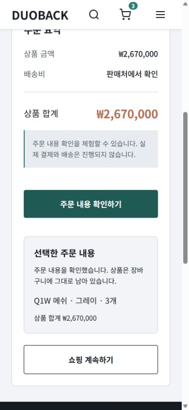

# 1차 개선 — 신뢰와 동작 범위 정리

2026-10-14 · 기존 AI 인상 분석의 P0 항목을 먼저 적용했다.

## 변경한 동작

- 모든 모델에 공유되던 가상 리뷰 3개, 고정 평점 4.8, 리뷰 수·인기도·출시일 예시 통계를 제거했다. 정렬은 등록순과 가격순만 제공한다.
- 출처 없는 인증 번호·보증 기간·수상 로고·연혁·매장 주소와 연락처를 제거했다. 홈 인증 섹션은 구매 전 확인 체크리스트로 교체했다.
- 가격·사양의 예시 범위를 화면에 표시했다. 공식 사이트처럼 읽히던 연구 기간과 건강 효능 문구를 제품 탐색 설명으로 바꿨다.
- 공통 듀얼백·에어 메쉬 설명을 제거하고 모델별 팔걸이·소재 데이터와 앞/측면 사진을 보여준다. 사양 자체의 제조사 원본 검증은 아직 진행하지 않았다.
- 배송·반품·보증·결제 안내를 `src/data/purchase-guide.js`에서 공통 관리한다. 임의의 판매 조건을 제시하는 대신 판매처에서 확인할 내용을 안내한다.
- A/S는 제출 전부터 입력 체험임을 안내한다. 제품·예시 구매일·예시 증상만 입력하며 개인 연락처는 요구하지 않는다. 필수 입력 확인 후 입력 내용과 실제 미접수 상태를 보여준다. 입력을 수정하면 이전 확인 결과를 숨긴다.
- 결제 버튼은 주문 내용 확인으로 변경했다. 선택 상품·색상·수량·합계를 보여주고 장바구니를 보존한다. 장바구니를 변경하면 이전 확인 결과를 숨긴다. 새로고침 후에도 상품은 유지된다.
- 로그인·채용·SNS·약관의 ‘준비 중’ 조작을 제거하고 실제 존재하는 탐색·구매 전 확인·프로젝트/저장 안내로 연결했다.
- 상세 탭의 방향키·Home/End 탐색과 탭/패널 연결, 키보드 포커스 표시를 추가했다. 페이지 언어와 기본 제목을 한국어로 설정했다.

## 확인한 개선

| 항목 | 이전 | 현재 |
|---|---|---|
| 실제 후기처럼 보이는 공유 리뷰·고정 평점 | 제품 5종 | 표시 없음 |
| 전송 없는 A/S 접수 완료 안내 | 1개 경로 | 없음; 입력 체험 결과로 교체 |
| 주문 확인 시 장바구니 소실 | 1개 경로 | 상품·색상·수량 유지 |
| 정책/연락처의 확인된 불일치 | 2종 | 해당 임의 정책·연락처 제거 및 안내 통합 |
| ‘준비 중’ alert 조작 | 7개 | 0개 |
| 상세 탭 방향키 실패 | 1종 | 방향키와 Home/End로 이동 가능 |

정보를 제거한 항목은 데이터 신뢰와 범위 표현을 개선한 것이다. 실제 리뷰·인증·매장 기능을 완성했다는 의미는 아니다. 사용자 인상이나 전환율은 측정하지 않았다.

## 검증

- ESLint 통과, 기존 데이터 테스트 3개 통과.
- Vite 프로덕션 빌드 통과. Windows 한글 프로젝트 경로에서 직접 빌드가 중단되어 ASCII 임시 폴더에서 빌드한 산출물을 사용했다.
- 데스크톱에서 상세 탭 키보드 이동, 상품 색상/수량 선택, 주문 내용 확인, 새로고침 후 장바구니 유지, 수량 변경 시 이전 결과 제거를 확인했다.
- A/S의 빈 필수 입력 차단, 예시 입력 결과, 수정 시 이전 결과 제거, 화면 이탈 후 입력 소멸을 확인했다.
- 390×844에서 A/S 폼과 주문 확인 화면을 점검했다. A/S 폼 폭은 327px이며 가로 넘침이 없었다.
- 실제 결제·수리 신청·외부 메시지·배포는 수행하지 않았다.

## 다음 단계

1. 제조사 원본으로 모델별 사진·사양을 대조한다.
2. 예산 필터와 모델 비교로 선택 흐름을 개선한다.
3. 모바일 히어로 지표 높이, 장식·폰트, 검색/모바일 메뉴의 포커스 순환을 정리한다.

기존 분석의 모바일 439→96px 목표와 비교 클릭 감소는 아직 구현 결과가 아니다.
